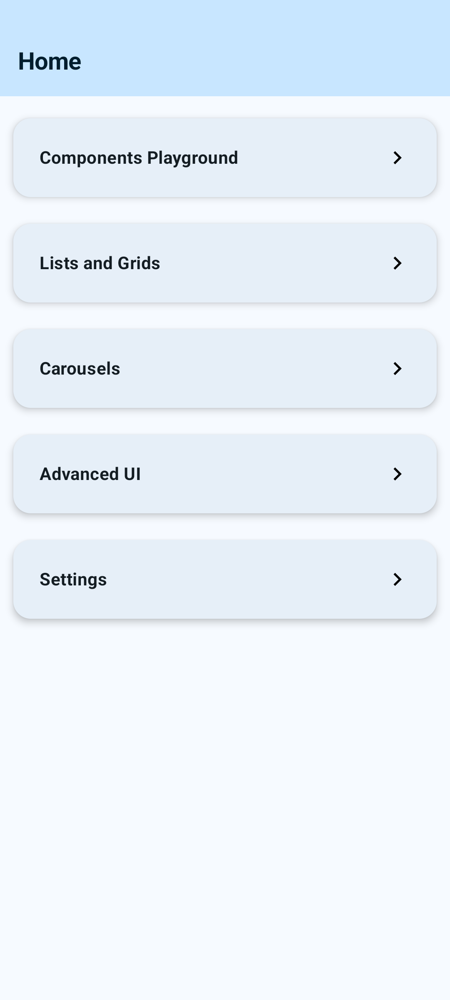
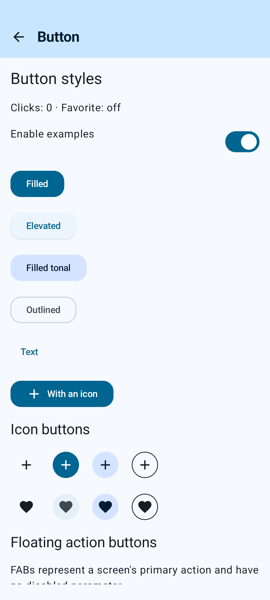
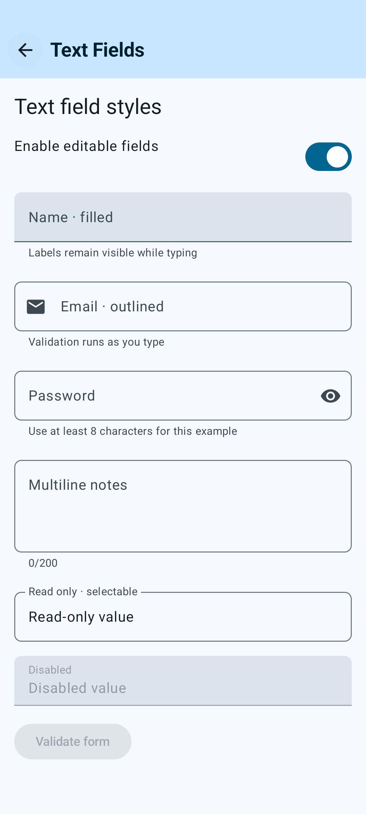
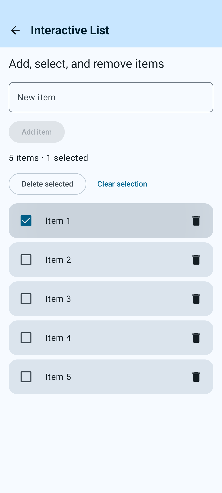
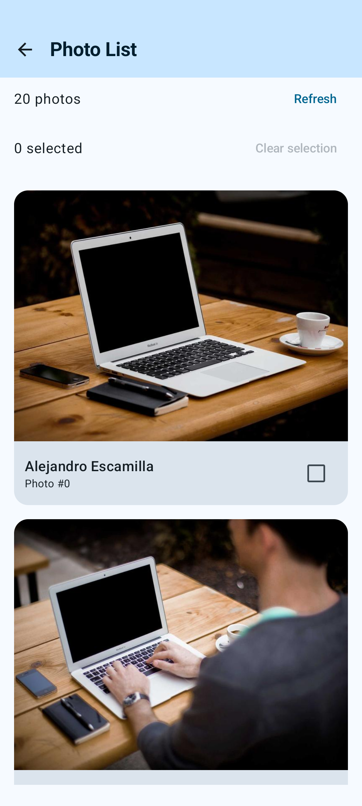
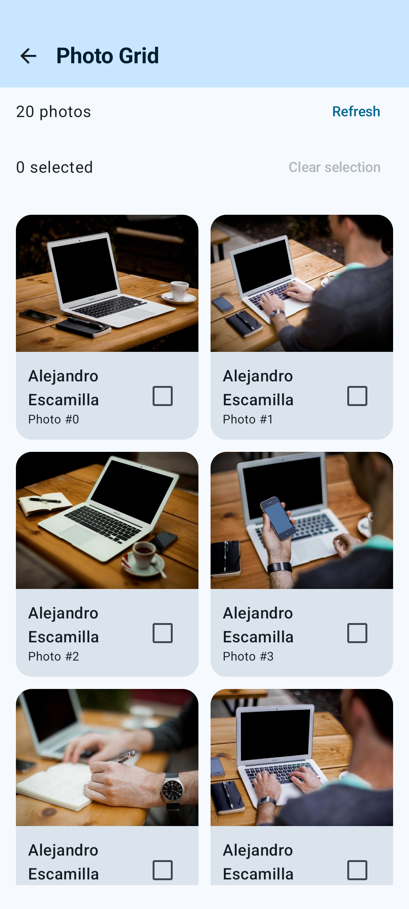
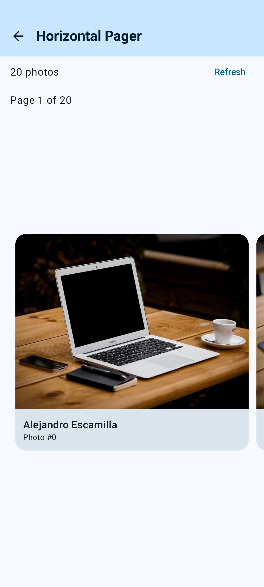
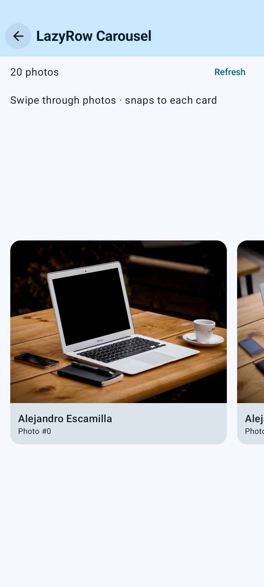
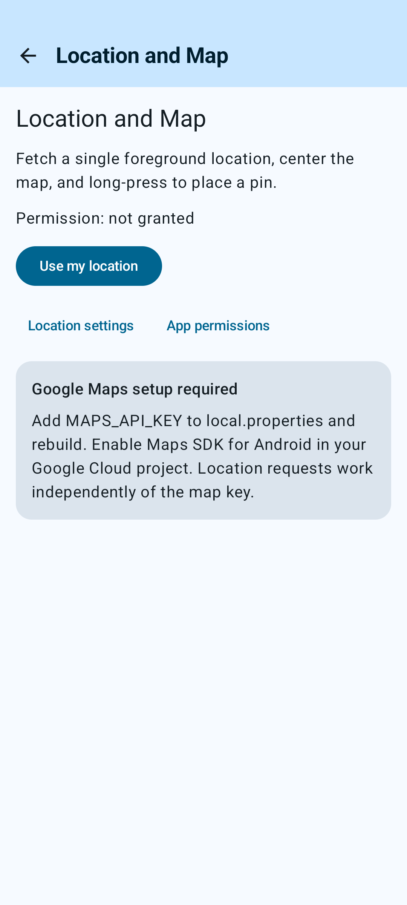
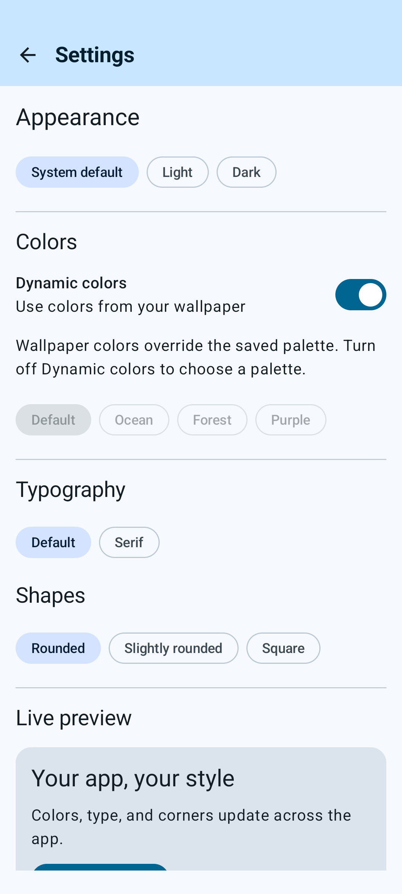

# Android Jetpack Compose Examples

An Android sample app for learning Kotlin, Jetpack Compose, and Material 3 through interactive examples. Explore component states, editable lists, remote photos, carousels, location permissions, maps, and persistent themes.

## Contents

- [Examples](#examples)
- [Getting started](#getting-started)
- [Photo and Maps setup](#photo-and-maps-setup)
- [Architecture](#architecture)
- [Build and test](#build-and-test)
- [Updating screenshots](#updating-screenshots)
- [License](#license)



## Examples

Choose a category from Home. Example names link to the implementation; click a screenshot to open the full image.

| Category | Example / source | What you can explore | Screenshot |
| --- | --- | --- | --- |
| Components Playground | [Buttons](app/src/main/java/com/example/androidjetpackcomposeexamples/views/ButtonExampleScreen.kt) | Filled, elevated, tonal, outlined, text and icon buttons; icon toggles; FABs; single/multiple segmented selection; disabled and loading states | [](docs/screenshots/buttons.png) |
| Components Playground | [Text Fields](app/src/main/java/com/example/androidjetpackcomposeexamples/views/TextFieldsExampleScreen.kt) | Filled/outlined inputs, validation, password visibility, keyboard actions, multiline notes, read-only and disabled fields | [](docs/screenshots/text-fields.png) |
| Lists and Grids | [Interactive List](app/src/main/java/com/example/androidjetpackcomposeexamples/views/EditableListScreen.kt) | Add and remove items, select rows, delete selected items, clear selection, and restore local list state | [](docs/screenshots/interactive-list.png) |
| Lists and Grids | [Photo List](app/src/main/java/com/example/androidjetpackcomposeexamples/views/PhotoExamplesScreen.kt) | Photo cards, selection, API pagination, loading/error states, refresh and retry | [](docs/screenshots/photo-list.png) |
| Lists and Grids | [Photo Grid](app/src/main/java/com/example/androidjetpackcomposeexamples/views/PhotoExamplesScreen.kt) | Adaptive columns, stable item keys, photo selection and pagination | [](docs/screenshots/photo-grid.png) |
| Carousels | [Horizontal Pager](app/src/main/java/com/example/androidjetpackcomposeexamples/views/PhotoExamplesScreen.kt) | Page-based photo browsing with `HorizontalPager`, a current-page indicator and lazy images | [](docs/screenshots/horizontal-pager.png) |
| Carousels | [LazyRow Carousel](app/src/main/java/com/example/androidjetpackcomposeexamples/views/PhotoExamplesScreen.kt) | Horizontal photo cards, snapping, API pagination and lazy image loading | [](docs/screenshots/lazy-row-carousel.png) |
| Advanced UI | [Location and Map](app/src/main/java/com/example/androidjetpackcomposeexamples/views/LocationMapScreen.kt) | Approximate/precise permission, one-shot location and accuracy, map markers, satellite mode and long-press pins; map requires an API key | [](docs/screenshots/location-map.png) |
| Settings | [Themes and Styles](app/src/main/java/com/example/androidjetpackcomposeexamples/views/SettingsScreen.kt) | System/light/dark appearance, four palettes, wallpaper colors, typography, shapes, persistent preferences and [live preview](docs/screenshots/settings-preview.png) | [](docs/screenshots/settings.png) |

Screenshots are captured from the running app on an Android emulator. The Location and Map screenshot shows the key setup state; it does not demonstrate authorized map tiles or a device location fix.

## Getting started

1. Clone the repository and open it in Android Studio with support for the project's Android Gradle plugin.
2. Install Android SDK **37**, the project's compile/target SDK. Run on Android **13 / API 33** or newer.
3. Let Gradle sync, then run the `app` configuration on a device or emulator. The wrapper's daemon toolchain configuration requests JDK **25**; source compatibility is Java 11.

For location/maps, use a device with working Google Play services or a Google APIs/Play Store emulator image. The other examples do not require a Maps API key.

## Photo and Maps setup

**Photos:** [Lorem Picsum](https://picsum.photos/) supplies paginated metadata and images without an API key. Photo examples require internet access. Author names appear on the cards. Coil handles image loading and memory/disk caching.

**Google Maps:** Enable Maps SDK for Android in a Google Cloud project with billing configured, create a restricted Android API key, then add it to the root `local.properties`:

```properties
MAPS_API_KEY=your_key_here
```

Rebuild after changing the key. `local.properties` is ignored by Git; keep real keys out of commits. Without a key, the screen shows setup instructions while location retrieval remains available independently. See the [full Maps setup guide](EXAMPLES.md#map-setup) for package/certificate restrictions and emulator configuration.

## Architecture

- **Navigation:** serializable typed routes, a shared `NavHostController`, and navigation callbacks passed to screens.
- **State:** feature ViewModels expose `StateFlow`, observed with lifecycle-aware collection.
- **Photos:** API → shared repository → destination ViewModel → Compose UI, with a bounded metadata cache and separate Coil image caches.
- **Location:** a testable provider handles one-shot requests; permissions and map interactions stay in the UI.
- **Settings:** an app-scoped Preferences DataStore persists appearance choices and applies them above the navigation tree.

Read [EXAMPLES.md](EXAMPLES.md) for behavior, setup details, and architecture notes.

## Build and test

```bash
# Unit tests and debug APK
./gradlew :app:testDebugUnitTest :app:assembleDebug

# UI tests with a running emulator or connected device
./gradlew :app:connectedDebugAndroidTest
```

Tests cover repository caching, pagination/retry, list editing, location state, settings persistence/reset, and navigation. Most UI tests inject photo metadata; the opt-in screenshot capture uses the live photo service.

## Updating screenshots

With an emulator running, capture the current screens using the opt-in instrumentation test:

```bash
./gradlew :app:connectedDebugAndroidTest \
  -Pandroid.testInstrumentationRunnerArguments.class=com.example.androidjetpackcomposeexamples.ReadmeScreenshotsTest \
  -Pandroid.testInstrumentationRunnerArguments.captureReadme=true

# Find the latest timestamped capture folder, then replace <capture-folder> below.
adb shell ls /sdcard/Pictures/ComposeReadme
adb pull "/sdcard/Pictures/ComposeReadme/<capture-folder>/." docs/screenshots/
```

The capture test is skipped in normal test runs. It waits for live photos to load, selects one local list item for illustration, and does not request location permission. Screenshots use the app's current appearance preferences. Review the images before committing them; rerun capture when the UI changes.

## License

This project is licensed under the [MIT License](LICENSE).
